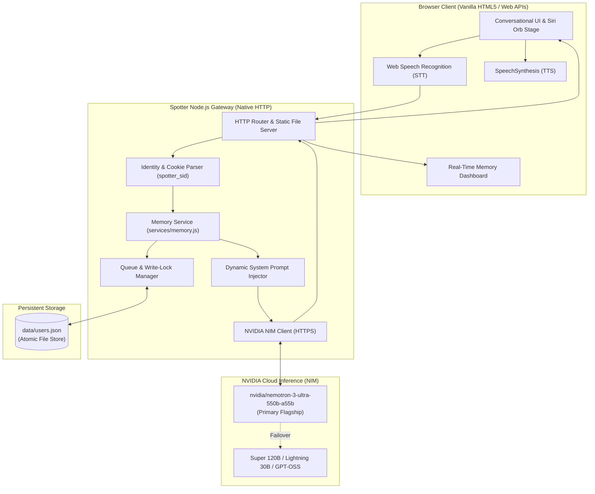
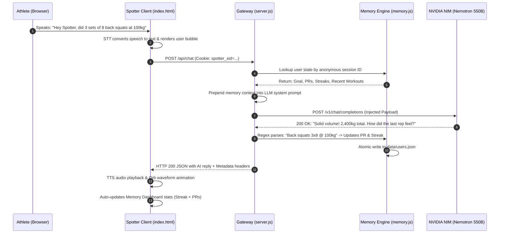

<div align="center">

# 🏋️ Spotter AI — Voice Fitness Coach & Companion

**An ultra-low latency, real-time voice coaching assistant powered by NVIDIA Nemotron (550B) with persistent anonymous memory.**

[](https://nodejs.org/)
[](https://build.nvidia.com/)
[](https://nodejs.org/api/)
[](./data/users.json)
[](./LICENSE)

[Live Demo](#-getting-started) • [Architecture](#-system-architecture) • [Memory System](#-memory--persistence-engine) • [API Reference](#-api-specification) • [Deployment](#-deployment--production)

</div>

---

## 📋 Executive Overview

**Spotter AI** is an AI-powered fitness companion engineered to bridge the gap between static workout trackers and human personal trainers. It pairs an animated conversational voice user interface with an atomic, zero-database memory engine and an enterprise LLM proxy routing directly to **NVIDIA NIM (Nemotron)**.

### Key Highlights
- **🎙️ Real-time Voice & Visual Feedback**: Fluid, responsive Siri-style audio orb and real-time Web Speech recognition with speech synthesis feedback.
- **⚡ NVIDIA Nemotron Flagship Intelligence**: High-throughput chat completions driven by `nvidia/nemotron-3-ultra-550b-a55b` with multi-tier failover.
- **🧠 Frictionless Persistent Memory**: Anonymous, cookie-anchored state tracking (`spotter_sid`) retaining fitness goals, personal records (PRs), workout volume, and active streaks across sessions without requiring logins or database overhead.
- **🔄 Conversational Intent & Workout Extraction**: Automated pattern recognition parses conversational logs (e.g., *"Did 3 sets of 10 bench press at 80kg"*) into structured workout logs on the fly.
- **🛡️ Secure Gateway**: Server-side credential isolation ensuring raw API tokens never touch browser runtime. Zero external NPM runtime dependencies.

---

## 🏗️ System Architecture

Spotter is designed with an intentionally lean, zero-bloat architecture: the front-end runs purely on standard web platform APIs, while the backend utilizes native Node.js HTTP/HTTPS primitives with an atomic write-lock storage subsystem.

### High-Level Topology



---

## 🔄 End-to-End Sequence Lifecycle



---

## 🧠 Memory & Persistence Engine

Unlike standard stateless LLM wrappers, Spotter implements a deterministic memory system tailored for fitness progression:

### 1. Anonymous Identity Resolution
When a user accesses Spotter, the backend evaluates the incoming `spotter_sid` cookie. If absent, a cryptographically random UUID v4 identifier is minted and returned via an `HttpOnly`, `SameSite=Lax` cookie valid for 365 days.

### 2. Atomic Storage & Concurrency
Persistent data is maintained in [`data/users.json`](./data/users.json). Writes are serialized through an asynchronous queue lock mechanism to prevent race conditions during concurrent interactions.

### 3. Context Injection Pipeline
Before routing prompts to NVIDIA NIM, `services/memory.js` constructs an injected context payload:
```text
=== SAVED USER CONTEXT (from previous sessions) ===
- Profile: Goal: Be 100 kgs by november this year | Level: Intermediate
- Active Streak: 3 consecutive days
- Personal Records:
  * Bench press: 85kg
  * Back squat: 100kg
- Recent Workouts:
  * 2026-10-12: Back squat (3 sets, max 100kg)
  * 2026-10-11: Bench press (4 sets, max 85kg)
Use this saved context naturally in your coaching. Acknowledge PRs, encourage streaks, and adjust advice accordingly.
```

### 4. Dynamic NLP Intent Extraction
The gateway automatically inspects conversation pairs for workout logs and fitness aspirations:
- **Workout Patterns**: Matches expressions like `did 3 sets of 10 bench at 80kg` or `logged squats 4x8 @ 100`.
- **Goal Statements**: Detects statements like `my goal is to bulk up` or `i want to hit a 140kg deadlift`.

---

## 🤖 AI Model Fallback Strategy

Spotter connects directly to NVIDIA NIM's OpenAI-compatible completions endpoint (`integrate.api.nvidia.com`). To guarantee high availability, the server enforces a robust fallback cascade:

| Priority | Model Identifier | Architecture | Target Role |
| :---: | :--- | :--- | :--- |
| **Primary** | `nvidia/nemotron-3-ultra-550b-a55b` | 550B MoE Transformer | High-reasoning coaching, volume analytics, programming |
| **Secondary** | `nvidia/nemotron-3-super-120b-a12b` | 120B Dense Transformer | Rapid coaching responses & routine suggestions |
| **Tertiary** | `nvidia/nemotron-3.5-lightning-30b-a3b` | 30B Compact | Low-latency voice turnaround |
| **Fallback** | `openai/gpt-oss-20b` | 20B General Purpose | Failsafe uptime fallback |

---

## 📁 Repository Structure

```text
SpotterAI-main/
├── api/
│   ├── chat.js                 # Vercel serverless function for AI completions
│   └── health.js               # Vercel serverless function for health checks
├── data/
│   └── users.json              # Atomic persistent storage for profiles & memory
├── public/
│   └── index.html              # Canonical Single-Page Application (SPA)
├── services/
│   └── memory.js               # Memory CRUD, lock manager & context builder
├── .gitignore                  # Excludes secrets, runtime data & node_modules
├── config.json                 # Active local configuration (NEMOTRON_API_KEY)
├── config.json.example         # Reference configuration template
├── index.html                  # Root static entry point (mirrors public/index.html)
├── package.json                # Project manifest & execution scripts
├── README.md                   # Complete architectural & operational guide
├── server.js                   # Production Node.js HTTP gateway & proxy
└── vercel.json                 # Vercel Edge/Serverless routing configuration
```

---

## 🚀 Getting Started

### Prerequisites
- **Node.js**: v18.0.0 or higher ([Download](https://nodejs.org/))
- **NVIDIA NIM API Key**: Free tier or enterprise key from [build.nvidia.com](https://build.nvidia.com/)

### 1. Clone & Setup
```bash
git clone https://github.com/your-username/SpotterAI-main.git
cd SpotterAI-main
```

### 2. Configure Your API Key
Create a `config.json` in the project root:
```json
{
  "NEMOTRON_API_KEY": "nvapi-YOUR_NVIDIA_API_KEY_HERE"
}
```

*Alternatively, export it as an environment variable:*
```bash
# macOS / Linux
export NEMOTRON_API_KEY="nvapi-YOUR_NVIDIA_API_KEY_HERE"

# Windows (PowerShell)
$env:NEMOTRON_API_KEY="nvapi-YOUR_NVIDIA_API_KEY_HERE"
```

### 3. Launch the Application
```bash
node server.js
```
*Or using npm:*
```bash
npm start
```

### 4. Access the Dashboard
Navigate to **`http://localhost:3000`** in any modern web browser (Google Chrome, Edge, Safari).

---

## 🔌 API Specification

### `GET /api/health`
Validates gateway connectivity, API key readiness, and memory subsystem status.
- **Response `200 OK`**:
```json
{
  "ok": true,
  "hasKey": true,
  "provider": "Nemotron",
  "memory": true
}
```

---

### `GET /api/memory-status`
Returns profile and historical tracking metrics for the session identified by `spotter_sid`.
- **Headers**: `Cookie: spotter_sid=<uuid>`
- **Response `200 OK`**:
```json
{
  "exists": true,
  "userId": "spotter-d1fcb87d-e388-4f8a-be19-b0d8a528f543",
  "workoutCount": 3,
  "streak": 2,
  "personalRecords": 1,
  "profile": {
    "goal": "Be 100 kgs by november this year",
    "experience": "Intermediate",
    "equipment": ["Barbell", "Dumbbells"]
  },
  "preferences": {
    "coachingStyle": "Encouraging"
  },
  "lastUpdated": "2026-10-12T22:07:50.491Z",
  "createdAt": "2026-10-12T21:46:37.835Z"
}
```

---

### `POST /api/chat`
Proxies prompts to NVIDIA Nemotron, injects historical memory, and extracts workouts/goals from conversations.
- **Request Body**:
```json
{
  "messages": [
    { "role": "user", "content": "I finished 4 sets of 8 bench press at 85kg." }
  ],
  "max_tokens": 200,
  "temperature": 0.65
}
```
- **Response `200 OK`**:
```json
{
  "choices": [
    {
      "message": {
        "role": "assistant",
        "content": "Incredible work! That's a new Personal Record for your Bench Press at 85kg. Total volume: 2,720kg."
      }
    }
  ]
}
```
- **Response Headers**:
  - `X-Model-Used`: `nvidia/nemotron-3-ultra-550b-a55b`
  - `X-Spotter-User`: `spotter-d1fcb87d...`

---

### `POST /api/workout`
Explicit endpoint for recording structured workout sets.
- **Request Body**:
```json
{
  "exercise": "Deadlift",
  "sets": [
    { "reps": 5, "weightKg": 140 },
    { "reps": 5, "weightKg": 140 }
  ],
  "fatigue": "Moderate",
  "notes": "Felt smooth and controlled"
}
```
- **Response `200 OK`**:
```json
{
  "success": true,
  "workout": {
    "date": "2026-10-13",
    "exercise": "Deadlift",
    "sets": [{ "reps": 5, "weightKg": 140 }, { "reps": 5, "weightKg": 140 }],
    "fatigue": "Moderate",
    "notes": "Felt smooth and controlled",
    "savedAt": "2026-10-13T03:30:00.000Z"
  }
}
```

---

### `DELETE /api/clear-data`
GDPR/privacy-compliant endpoint to wipe session history and profile data.
- **Response `200 OK`**:
```json
{
  "success": true,
  "message": "All your data has been cleared."
}
```

---

## 🛠️ Production & Deployment Guide

### Option 1: Process Manager (PM2)
For self-hosted Linux VPS (Ubuntu/Debian) deployments:
```bash
npm install -g pm2
pm2 start server.js --name "spotter-ai"
pm2 startup
pm2 save
```

### Option 2: Docker Containerization
Create a `Dockerfile`:
```dockerfile
FROM node:18-alpine
WORKDIR /app
COPY package*.json ./
COPY . .
EXPOSE 3000
ENV NODE_ENV=production
CMD ["node", "server.js"]
```
Build and run:
```bash
docker build -t spotter-ai .
docker run -d -p 3000:3000 -e NEMOTRON_API_KEY="nvapi-..." --name spotter spotter-ai
```

### Option 3: Vercel Serverless
The repository includes pre-configured [`vercel.json`](./vercel.json) and serverless handlers in [`api/`](./api/):
1. Import repository to Vercel.
2. In Project Settings > Environment Variables, add:
   - `NEMOTRON_API_KEY`: `nvapi-YOUR_KEY_HERE`
3. Deploy.

---

## 🔒 Security & Privacy Considerations

1. **Server-Side Credential Guarding**: `NEMOTRON_API_KEY` is loaded strictly server-side and never forwarded to client assets.
2. **Path Traversal Protection**: Static asset resolution validates file paths using `path.basename()` and explicitly forbids access to sensitive files (e.g., `config.json`).
3. **Cookie Attributes**: Cookies are marked `HttpOnly` to mitigate XSS exposure and `SameSite=Lax` to safeguard against CSRF.
4. **Isolated Zero-Dependency Surface**: Running on native Node.js core libraries eliminates npm supply-chain vulnerabilities.

---

## 🤝 Contributing

Contributions from fitness engineers, AI researchers, and frontend developers are welcome!
1. Fork the Project.
2. Create your Feature Branch (`git checkout -b feature/AmazingFeature`).
3. Commit your Changes (`git commit -m 'Add some AmazingFeature'`).
4. Push to the Branch (`git push origin feature/AmazingFeature`).
5. Open a Pull Request.

---

## 📜 License

Distributed under the **MIT License**. See [`LICENSE`](./LICENSE) for more information.

<div align="center">
Built with dedication for athletes, lifters, and fitness enthusiasts worldwide.
</div>
